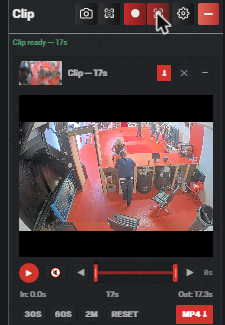
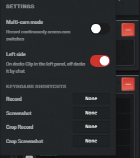

# Soon Tools 🐟

> Tampermonkey userscripts for [fishtank.live](https://www.fishtank.live) — built by [soon](https://x.com/emty_h3v) @ [fishtank.news](https://fishtank.news)

Soon Tools is a Tampermonkey userscript for clipping Fishtank Live.

---

## 🎬 Soon Clipper
Snipping tool–style video recorder for Fishtank Live. Record fullscreen or cropped selections, trim, and export to MP4.

  
  

**Features:**

- Fullscreen Record/Screenshot — Capture entire video stream at native resolution
- Crop Record/Screenshot (✂) — Drag to select region, clip only that area
- Max 5 minutes per clip — Auto-stops at 300 seconds
- Timeline Trim — Drag In/Out handles to set trim points
- Video Preview — Play/pause, scrub, mute controls
- Multicam Recordings
- Keyboard Shortcuts
- Download as MP4
- Matches custom themes
- Choose its location - Left or right side of screen

---

## 🗺️ Soon Map *(discontinued)*

Soon Map has been discontinued and is no longer maintained. If you still have it installed, it shows a banner asking you to uninstall it.

---

## ⚡ Installation

### 1. Install Tampermonkey

| Browser | Link |
| ------- | ---- |
| Chrome  | [Chrome Web Store](https://chrome.google.com/webstore/detail/tampermonkey/dhdgffkkebhmkfjojejmpbldmpobfkfo) |
| Firefox | [Firefox Add-ons](https://addons.mozilla.org/en-US/firefox/addon/tampermonkey/) |
| Edge    | [Edge Add-ons](https://microsoftedge.microsoft.com/addons/detail/tampermonkey/iikmkjmpaadaobahmlepeloendndfphd) |
| Safari  | [App Store](https://apps.apple.com/us/app/tampermonkey/id1482490089) |

**On Chrome, Edge and other Chromium browsers**, also turn on **Allow User Scripts**: right-click the Tampermonkey icon → **Manage extension**, then switch on **Allow User Scripts** (on older versions, switch on **Developer mode** at the top of `chrome://extensions` instead). Without it, the script installs but never runs.

### 2. Install Soon Clipper

Click the install button above — Tampermonkey will open a confirmation dialog.

### 3. Use it

Navigate to [fishtank.live](https://www.fishtank.live) — Soon Clipper appears automatically at the side of the screen (left or right, set in its settings).

---

*Made with ❤️ by [fishtank.news](https://fishtank.news)*
